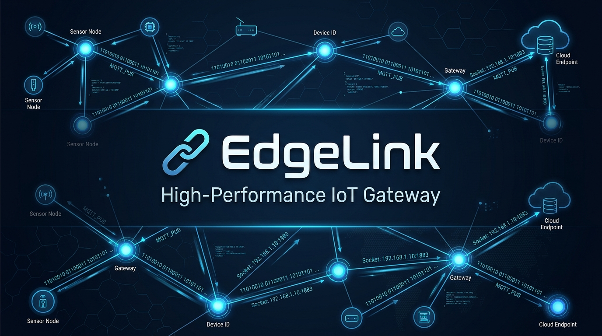

<p align="center">
  
</p>

<h1 align="center">EdgeLink — High-Performance Asynchronous Telemetry Gateway</h1>

<p align="center">
  <b>Промышленный асинхронный сетевой шлюз на C++20 для высоконагруженного сбора, валидации, нормализации и параллельной обработки телеметрии от сотен IoT-датчиков по протоколам TCP/UDP с поддержкой низкоуровневых RAW-сокетов (ICMP diagnostics).</b>
</p>

<p align="center">
  
  
  
  
  
  
  
</p>

---

## 📌 О проекте

**EdgeLink** решает задачу надежного приёма потоков разнородных телеметрических данных от распределенных устройств в условиях нестабильной промышленной сети. Шлюз способен обслуживать одновременные TCP/UDP подключения, выдерживать частичную потерю или фрагментацию сетевых пакетов, отсекать поврежденные данные по контрольным суммам CRC32 и передавать агрегированный нормализованный поток дальше потребителям без задержек и утечек памяти.

### Основные возможности

- **Высокая параллельная нагрузка**: Архитектура *Classic Reactor + Thread-per-Core* с `SO_REUSEPORT` и `epoll` в неблокирующем режиме (`EPOLLET`, `O_NONBLOCK`).
- **Сквозная обработка TCP-стрима**: Гарантированная сборка фрагментированных TCP-пакетов, склеенных сообщений и побайтовая ресинхронизация при нарушении сигнатуры пакета.
- **Двухсторонняя защита очереди (Backpressure & Drop Oldest)**: Ограниченная потокобезопасная очередь с политикой вытеснения устаревших данных при экстремальных нагрузках, предотвращающая исчерпание RAM (OOM).
- **Параллельный пул потоков (Thread Pool)**: Асинхронная нормализация величин (перевод температур в Кельвины, давлений в Паскали), проверка допустимых диапазонов датчиков и расчет статистических метрик в реальном времени.
- **Сетевая диагностика на RAW-сокетах**: Встроенный анализатор доступности узлов на базе протокола ICMP (`SOCK_RAW`, `IPPROTO_ICMP`) с замером RTT в микросекундах и безопасной работой через capability `cap_net_raw+ep`.
- **Генератор нагрузки (Device Simulator)**: Симулятор 100 виртуальных промышленных датчиков с рандомизированной генерацией шума, частичной отправкой TCP-фреймов, эмуляцией обрывов соединения и битых контрольных сумм.

---

## 🏗 Архитектура системы

Проект разделен на слабосвязанные слои по принципам Clean Architecture:

```
EdgeLink/
├── .github/
│   └── workflows/ci.yml         # Непрерывная интеграция GitHub Actions (CI)
├── docs/
│   └── images/banner.png        # Логотип и баннер проекта
├── include/edgelink/
│   ├── common/                  # Константы протокола (Magic, Version, Ports)
│   ├── model/                   # Модели предметной области (TelemetryRecord, TlvRecord, Stats)
│   ├── protocol/                # Бинарный TLV-парсер, сериализатор и расчет CRC32
│   ├── sync/                    # ThreadSafeQueue (Drop-Oldest) и кастомный ThreadPool
│   ├── network/                 # RAII Socket, EpollEventLoop, Connection, TcpServer, UdpServer
│   ├── service/                 # DataProcessor, TelemetryAggregator, MetricsRegistry
│   ├── diagnostics/             # RAW ICMP Echo/Ping монитор доступности
│   └── simulator/               # Симулятор 100 промышленных устройств
├── src/                         # Реализация компонентов ядра и исполняемых файлов
├── tests/                       # 19 модульных и интеграционных тестов (GoogleTest)
├── scripts/                     # Скрипты локального запуска (run_demo.sh)
├── Dockerfile                   # Многоэтапная сборка (multi-stage) с автоматическим запуском тестов
├── docker-compose.yml           # Декларативный стек: Gateway + Simulator + Diagnostics
├── CMakeLists.txt               # Конфигурация сборки C++20
├── LICENSE                      # Лицензия MIT
└── README.md                    # Документация проекта
```

---

## 📦 Формат бинарного протокола (TLV Frame)

Шлюз принимает бинарные кадры с контрольной суммой:

| Поле | Смещение | Размер | Описание |
| :--- | :---: | :---: | :--- |
| **Magic** | `0..1` | 2 байта | Идентификатор протокола (`0x544C` = "TL") |
| **Version** | `2` | 1 байт | Версия протокола (`1`) |
| **Flags** | `3` | 1 байт | Сервисные флаги |
| **Device ID** | `4..7` | 4 байта | Уникальный номер датчика (Big-Endian) |
| **Timestamp** | `8..15` | 8 байт | Метка времени UTC (мс) |
| **Payload Length** | `16..19` | 4 байта | Длина блока полезной нагрузки в байтах |
| **Payload (TLV)** | `20..N` | Переменный | Массив TLV-записей: `Tag (2B) + Length (2B) + Value (8B double)` |
| **CRC32** | `N+1..N+4` | 4 байта | Контрольная сумма заголовка и полезной нагрузки |

```
 0                   1                   2                   3
 0 1 2 3 4 5 6 7 8 9 0 1 2 3 4 5 6 7 8 9 0 1 2 3 4 5 6 7 8 9 0 1
+-+-+-+-+-+-+-+-+-+-+-+-+-+-+-+-+-+-+-+-+-+-+-+-+-+-+-+-+-+-+-+-+
|          Magic (0x544C)       |    Version    |     Flags     |
+-+-+-+-+-+-+-+-+-+-+-+-+-+-+-+-+-+-+-+-+-+-+-+-+-+-+-+-+-+-+-+-+
|                           Device ID                           |
+-+-+-+-+-+-+-+-+-+-+-+-+-+-+-+-+-+-+-+-+-+-+-+-+-+-+-+-+-+-+-+-+
|                                                               |
+                       Timestamp (uint64_t)                    +
|                                                               |
+-+-+-+-+-+-+-+-+-+-+-+-+-+-+-+-+-+-+-+-+-+-+-+-+-+-+-+-+-+-+-+-+
|                         Payload Length                        |
+-+-+-+-+-+-+-+-+-+-+-+-+-+-+-+-+-+-+-+-+-+-+-+-+-+-+-+-+-+-+-+-+
|       Tag (MetricType)        |          Length (8)           |
+-+-+-+-+-+-+-+-+-+-+-+-+-+-+-+-+-+-+-+-+-+-+-+-+-+-+-+-+-+-+-+-+
|                        Value (double IEEE 754)                |
|                                                               |
+-+-+-+-+-+-+-+-+-+-+-+-+-+-+-+-+-+-+-+-+-+-+-+-+-+-+-+-+-+-+-+-+
|                         CRC32 Checksum                        |
+-+-+-+-+-+-+-+-+-+-+-+-+-+-+-+-+-+-+-+-+-+-+-+-+-+-+-+-+-+-+-+-+
```

---

## ⚡ Пайплайн обработки данных

```
  [100 Virtual Devices]
    ├── TCP Streams (with partial writes & drops)
    └── UDP Datagrams
            │
            ▼
    [Epoll Event Loop] (Non-Blocking I/O, Edge-Triggered, SO_REUSEPORT)
            │
            ▼
    [Protocol Parser] (TLV unpacking, Stream Resync, CRC32 Check)
            │
            ▼
    [ThreadSafeQueue] (Drop Oldest Overload Protection)
            │
            ▼
    [Worker Thread Pool] (Parallel Processing)
       ├── Range Validation (Physics limits check)
       ├── Metric Normalization (SI Units: °C → K, bar → Pa)
       └── Aggregation (Min/Max/Avg/Count per Device)
            │
            ▼
    [Normalized Data Stream / Metrics Registry]
```

---

## 🚀 Быстрый запуск

### Вариант 1: Запуск через Docker Compose (Рекомендуемый)

Стек поднимает шлюз, симулятор 100 устройств и ICMP-диагностику в изолированной виртуальной сети:

```bash
docker compose up
```

В процессе multi-stage сборки Dockerfile автоматически компилирует проект под Ubuntu 24.04 и прогоняет 100% модульных тестов.

Для остановки контейнеров:
```bash
docker compose down
```

---

### Вариант 2: Локальная сборка в Linux / WSL

#### 1. Установка сборочных зависимостей:
```bash
sudo apt-get update && sudo apt-get install -y build-essential cmake ninja-build libcap2-bin
```

#### 2. Конфигурация и компиляция:
```bash
cmake -B build -S . -DCMAKE_BUILD_TYPE=Release
cmake --build build -j$(nproc)
```

#### 3. Запуск автоматического демонстрационного сценария:
Скрипт запускает шлюз, подключает 100 датчиков, выводит живую статистику обработки пакетов (~1000 msg/s) и корректно завершает процессы (Graceful Shutdown):
```bash
./scripts/run_demo.sh
```

---

## 🧪 Тестирование (GoogleTest)

В проекте реализовано 19 автоматических тестов, покрывающих критические участки логики:

- **Protocol & CRC**: Расчет контрольных сумм по RFC 3720, сериализация/десериализация TLV-кадров, обнаружение повреждений.
- **TCP Stream Robustness**: Склейка нескольких пакетов в одном чтении, приём пакетов по 1–2 байта (фрагментация), побайтовая ресинхронизация при мусорных байтах в потоке.
- **Concurrency & Queuing**: Отсутствие взаимных блокировок (deadlocks) в `ThreadSafeQueue` в режиме multi-producer / multi-consumer, корректная работа стратегии `Drop Oldest`.
- **Thread Pool**: Выполнение задач через `std::future`, параллельный стресс-тест на 1000 асинхронных задач.
- **Integration**: Сквозная одновременная передача данных по TCP и UDP на работающий шлюз с агрегацией метрик.

Запуск тестов:
```bash
./build/edgelink_tests
```

```
[==========] Running 19 tests from 6 test suites ran. (210 ms total)
[  PASSED  ] 19 tests.
```

---

## 🔍 Сетевая диагностика (RAW Sockets)

Утилита `edgelink_diagnostics` формирует низкоуровневые ICMP Echo Request пакеты и анализирует эхо-ответы:

```bash
# Пинг узла через созданный сокет SOCK_RAW (5 пакетов)
sudo ./build/edgelink_diagnostics 127.0.0.1 5
```

Пример вывода:
```text
EdgeLink RAW Socket ICMP Diagnostics
Target: 127.0.0.1, Count: 5
Reply from 127.0.0.1: seq=1 ttl=64 time=0.08 ms
Reply from 127.0.0.1: seq=2 ttl=64 time=0.06 ms
Reply from 127.0.0.1: seq=3 ttl=64 time=0.07 ms
Reply from 127.0.0.1: seq=4 ttl=64 time=0.06 ms
Reply from 127.0.0.1: seq=5 ttl=64 time=0.07 ms

--- 127.0.0.1 ping statistics ---
5 packets transmitted, 5 received, 0% packet loss
avg RTT = 0.07 ms
```

> **Безопасность**: В Docker-образе исполняемому файлу назначен атрибут `cap_net_raw+ep`, что позволяет работать с `SOCK_RAW` без повышения прав до суперпользователя `root`.

---

## 🛠 Технологический стек

| Категория | Технологии |
| :--- | :--- |
| **Язык** | C++20 (`std::span`, `std::bit_cast`, Concepts, Structured Binding) |
| **ОС / API** | Linux Kernel, POSIX API (`epoll`, `eventfd`, `accept4`, non-blocking I/O) |
| **Сетевой стек** | TCP/IP (Stream sockets), UDP (Datagrams), RAW Sockets (`IPPROTO_ICMP`) |
| **Многопоточность** | `std::jthread`/`std::thread`, `std::mutex`, `std::shared_mutex`, `std::condition_variable`, `std::atomic` |
| **Сборка** | CMake 3.20+, Ninja, GCC 13+ |
| **Тесты** | GoogleTest (GTest / GMock через CMake FetchContent) |
| **Контейнеризация** | Docker, Docker Compose, Linux Capabilities (`CAP_NET_RAW`) |

---

## 📄 Лицензия

Проект распространяется под открытой лицензией [MIT](LICENSE).
